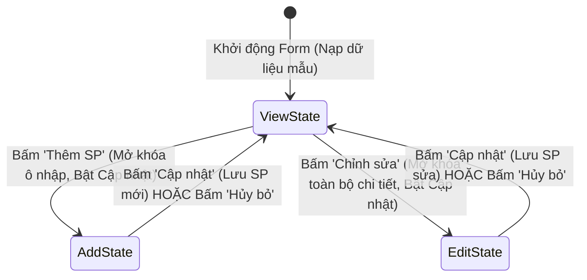

# BÁO CÁO THUYẾT TRÌNH VÀ HƯỚNG DẪN DEMO LAB 06
## MÔN HỌC: COMP1019 – LẬP TRÌNH TRÊN WINDOWS
### ĐỀ TÀI: WINDOWS FORMS NÂNG CAO & DATAGRIDVIEW (PRODUCT MANAGER)
### CHỦ ĐỀ CHUYÊN SÂU: NHÓM 3 - STATUSSTRIP, THỐNG KÊ TỒN KHO & ĐỌC/GHI FILE (SAVEFILEDIALOG)

---

## I. TỔNG QUAN HỆ THỐNG VÀ CẤU TRÚC DỰ ÁN

Hệ thống **ProductManager** được xây dựng trên nền tảng **.NET (Windows Forms)** với kiến trúc hướng đối tượng (OOP), tuân thủ nguyên tắc Clean Code và sử dụng các thuật toán cơ bản, trong sáng, phù hợp với trình độ sinh viên năm 2–3 ngành Công nghệ Thông tin.

### 1. Cấu trúc thư mục mã nguồn
```text
Lab06/
│
├── Models/
│   └── Product.cs             # Lớp thực thể Product với đầy đủ các thuộc tính theo đề bài
│
├── Services/
│   ├── ProductFileService.cs  # Dịch vụ xuất file .txt và .csv sử dụng StreamWriter
│   └── SampleDataHelper.cs    # Khởi tạo dữ liệu mẫu và tạo hình ảnh minh họa tự động
│
├── Form1.cs                   # Code-behind xử lý logic nghiệp vụ, State Pattern và StatusStrip
├── Form1.Designer.cs          # Thiết kế giao diện Windows Forms trực quan, hiện đại
└── Program.cs                 # Điểm khởi chạy ứng dụng
```

---

## II. ĐÁP ỨNG ĐẦY ĐỦ YÊU CẦU NỀN TẢNG (YÊU CẦU I)

### 1. Lớp đối tượng `Product` (`Models/Product.cs`)
Bao gồm đầy đủ các thuộc tính theo yêu cầu nghiệp vụ:
- `MaSP` (`string`): Mã sản phẩm (định danh duy nhất).
- `TenSP` (`string`): Tên sản phẩm.
- `LoaiSP` (`string`): Loại/Danh mục sản phẩm (Điện thoại, Laptop, Phụ kiện...).
- `DonGia` (`decimal`): Đơn giá bán (VNĐ).
- `SoLuong` (`int`): Số lượng hàng tồn trong kho.
- `NgayNhap` (`DateTime`): Ngày nhập hàng.
- `ConKinhDoanh` (`bool`): Trạng thái kinh doanh (`true`: Đang bán, `false`: Ngừng bán).
- `DuongDanAnh` (`string`): Đường dẫn lưu trữ hình ảnh minh họa (lưu trữ ngầm trong bộ nhớ và nạp trực tiếp lên PictureBox, loại bỏ hoàn toàn hiển thị đường dẫn dạng văn bản hoặc cột trong bảng DataGridView).
- *Thuộc tính bổ trợ*: `ThanhTien => DonGia * SoLuong` phục vụ thống kê trực quan.

### 2. Quản lý danh sách trong bộ nhớ bằng `BindingList<Product>` & `BindingSource`
- Sử dụng `BindingList<Product>` thay vì `List<Product>` vì `BindingList` có cơ chế phát sinh sự kiện `ListChanged`, giúp **DataGridView tự động cập nhật ngay lập tức** khi có thao tác Thêm, Sửa, Xóa mà không cần gán lại DataSource thủ công.
- Sử dụng `BindingSource` làm tầng trung gian để hỗ trợ các thao tác tìm kiếm, lọc dữ liệu mà không làm mất danh sách gốc.

### 3. Dữ liệu mẫu ban đầu
- Khởi động Form có sẵn **5 sản phẩm mẫu** (vượt yêu cầu tối thiểu 3 sản phẩm), bao gồm đa dạng các mặt hàng công nghệ (iPhone 15 Pro Max, MacBook Air M3, Bàn phím Logitech MX, Samsung Galaxy S24 Ultra, Tai nghe Sony WH-1000XM5) kèm hình ảnh minh họa trực quan.

---

## III. QUẢN LÝ LUỒNG TRẠNG THÁI FORM (FORM STATE WORKFLOW)

Hệ thống áp dụng chuẩn mực thiết kế an toàn dữ liệu với 3 trạng thái Form rõ ràng:



1. **Trạng thái Xem (`FormMode.View`)**:
   - Khi vừa mở Form hoặc khi click chọn các dòng trên DataGridView để xem thông tin chi tiết:
     - **TẤT CẢ các thông tin chi tiết BỊ KHÓA HOÀN TOÀN** (`ReadOnly = true` / `Enabled = false`). Người dùng không thể gõ nhầm hay làm sai lệch dữ liệu.
     - **Nút "Cập nhật" và "Hủy bỏ" bị vô hiệu hóa** (`btnCapNhat.Enabled = false`, `btnHuy.Enabled = false`).
     - Cho phép bấm các nút: `Thêm SP`, `Chỉnh sửa`, `Xóa SP`, `Làm mới`, `Xuất File`.

2. **Trạng thái Thêm mới (`FormMode.Add`)**:
   - Kích hoạt khi bấm nút **"➕ Thêm SP"**:
     - Xóa trắng form nhập liệu, trỏ con trỏ vào ô Mã SP.
     - Mở khóa các trường nhập liệu (`ReadOnly = false`, `Enabled = true`).
     - **Nút "Cập nhật" được kích hoạt** (`btnCapNhat.Enabled = true`).
     - Nút "Hủy bỏ" được kích hoạt để có thể quay lại chế độ xem bất cứ lúc nào.

3. **Trạng thái Chỉnh sửa (`FormMode.Edit`)**:
   - Kích hoạt khi bấm nút **"✏️ Chỉnh sửa"**:
     - Yêu cầu phải chọn 1 sản phẩm trên danh sách.
     - **MỞ KHÓA TẤT CẢ CÁC THÔNG TIN CHI TIẾT ĐỂ CHỈNH SỬA**: Tên SP, Loại SP, Đơn giá, Số lượng, Ngày nhập, Tình trạng kinh doanh, Nút chọn/xóa ảnh.
     - **Nút "Cập nhật" được kích hoạt** (`btnCapNhat.Enabled = true`).
     - Các nút Thêm, Chỉnh sửa, Xóa tạm thời vô hiệu hóa để tránh xung đột luồng.

4. **Khi ấn nút "💾 Cập nhật"**:
   - Tự động nhận diện đang ở chế độ Thêm mới hay Chỉnh sửa:
     - Nếu Thêm: Validate không trùng mã, thêm vào danh sách, đồng bộ DataGridView, cập nhật StatusStrip.
     - Nếu Sửa: Validate, cập nhật thông tin đối tượng, làm mới DataGridView, cập nhật StatusStrip.
   - Sau khi lưu thành công, hệ thống **tự động đưa Form về lại Chế độ Xem (`FormMode.View`)**: Khóa lại toàn bộ thông tin chi tiết và tắt nút Cập nhật.

---

## IV. NỘI DUNG TÌM HIỂU CHUYÊN SÂU & THUYẾT TRÌNH (NHÓM 3)

### 1. Kỹ thuật cập nhật StatusStrip theo thời gian thực (Real-time)
- **Mục tiêu**: Cung cấp phản hồi ngay tức thì (Feedback loop) cho người dùng sau mỗi tương tác, tăng trải nghiệm người dùng (UX).
- **Thành phần thanh StatusStrip (`statusStrip1`)**:
  - `lblTrangThai` (`ToolStripStatusLabel`, `Spring = true`): Chiếm toàn bộ không gian còn trống bên trái, hiển thị thông điệp trạng thái chi tiết của hành động vừa thực hiện:
    - `"🟢 Sẵn sàng | Đã nạp thành công 5 sản phẩm mẫu"`
    - `"📝 Đang ở chế độ Thêm mới SP. Vui lòng nhập thông tin rồi bấm 'Cập nhật' để lưu"`
    - `"✏️ Đang chỉnh sửa SP [SP01 - iPhone 15 Pro Max 256GB]..."`
    - `"✅ Vừa thêm mới SP [SP06] thành công"`
    - `"✏️ Đã cập nhật SP [SP01] thành công"`
    - `"🗑️ Đã xóa sản phẩm [SP03] khỏi hệ thống"`
    - `"🔎 Tìm thấy 2 sản phẩm phù hợp"`
    - `"💾 Đã xuất file thành công: BaoCaoTonKho_20261008.txt"`
  - `lblTongSanPham`: Hiển thị số lượng mặt hàng và tổng số lượng tồn kho.
  - `lblTongGiaTriTonKho`: Hiển thị tổng giá trị quy đổi thành tiền của toàn bộ kho hàng.
  - `lblDongHo`: Hiển thị ngày giờ hệ thống cập nhật liên tục mỗi giây bằng `System.Windows.Forms.Timer` (`Interval = 1000ms`).

### 2. Chỉ số thống kê: Công thức tính tổng giá trị tồn kho
- **Công thức toán học**:
  $$\text{Tổng giá trị tồn kho} = \sum_{i=1}^{n} (\text{Số lượng}_i \times \text{Đơn giá}_i)$$
- **Thuật toán triển khai trong mã nguồn (Đơn giản, trong sáng)**:
  ```csharp
  int soMatHang = _bindingSource.Count;
  int tongSoLuongTon = 0;
  decimal tongGiaTriTonKho = 0;

  foreach (Product sp in _bindingSource)
  {
      tongSoLuongTon += sp.SoLuong;
      decimal thanhTien = sp.SoLuong * sp.DonGia;
      tongGiaTriTonKho += thanhTien;
  }

  lblTongSanPham.Text = $"📦 Mặt hàng: {soMatHang} | Tổng SL tồn: {tongSoLuongTon:N0} chiếc";
  lblTongGiaTriTonKho.Text = $"💰 TỔNG TỒN KHO: {tongGiaTriTonKho:N0} VNĐ";
  ```
- **Điểm nổi bật**: Khi người dùng thực hiện lọc danh mục (ví dụ chỉ lọc "Điện thoại"), StatusStrip sẽ tự động tính toán tổng số lượng và tổng giá trị tồn kho riêng cho danh mục đó!

### 3. Cơ chế Đọc/Ghi File bằng `SaveFileDialog` và `StreamWriter`
- **Luồng xử lý I/O (Input/Output Stream)**:
  1. **Khởi tạo SaveFileDialog**: Thiết lập `Filter` hỗ trợ cả 2 định dạng:
     - `File văn bản báo cáo (*.txt)|*.txt`
     - `File bảng tính Excel (*.csv)|*.csv`
  2. **Người dùng chọn vị trí và đặt tên file**: `sfd.ShowDialog() == DialogResult.OK`.
  3. **Mở luồng ghi dữ liệu**: Dùng `using (StreamWriter writer = new StreamWriter(filePath, false, Encoding.UTF8))`.
     - Với file CSV: Sử dụng `new UTF8Encoding(true)` (UTF-8 with BOM) để khi mở bằng **Microsoft Excel không bị lỗi font tiếng Việt**.
  4. **Ghi định dạng báo cáo `.txt`**: Căn lề cột thẳng hàng bằng `string.Format("{0,-8} | {1,-26} | ...")`, có tiêu đề, chi tiết và tổng kết chân trang.
  5. **Mở file tự động sau khi xuất**: Dùng `Process.Start` để mở ngay file vừa tạo bằng Notepad hoặc Excel giúp demo ấn tượng.

---

## V. KỊCH BẢN THUYẾT TRÌNH & DEMO TỪNG BƯỚC (CHO NHÓM 3)

| Bước | Người thuyết trình nói | Thao tác trên phần mềm (Demo) | Điểm nhấn cần giảng giải |
|:---:|:---|:---|:---|
| **1** | *"Chào thầy và các bạn, hôm nay Nhóm 3 xin demo đề tài ProductManager với phần chuyên sâu về StatusStrip Real-time, Thống kê tồn kho và Quản lý trạng thái Form an toàn."* | Chạy ứng dụng từ Visual Studio hoặc `dotnet run`. | Form mở lên mượt mà. Tất cả các ô thông tin chi tiết đều đang bị KHÓA, nút 'Cập nhật' đang bị Disable để chống sửa nhầm. |
| **2** | *"Khi click vào các dòng trên DataGridView, dữ liệu và ảnh minh họa được nạp lên để XEM CHI TIẾT, nhưng các trường vẫn ở trạng thái chỉ đọc."* | Click chọn lần lượt các dòng trên DataGridView. | Xem thông tin nhảy lên các ô nhập liệu bên trên và `PictureBox` hiển thị ảnh minh họa tương ứng. Các ô không gõ vào được. |
| **3** | *"Quan sát StatusStrip dưới cùng: Trạng thái 'Sẵn sàng', tổng 5 mặt hàng, tổng tồn kho được tính toán tự động, đồng hồ chạy từng giây."* | Trỏ chuột vào thanh StatusStrip dưới cùng. | Giải thích nhãn `Spring=true` dạt trái, công thức $\sum(\text{SL} \times \text{Đơn giá})$. |
| **4** | *"Bây giờ em bấm 'Thêm SP'. Hệ thống xóa trắng ô nhập, MỞ KHÓA các trường và KÍCH HOẠT nút 'Cập nhật'."* | Bấm **Thêm SP**. Nhập: Mã `SP06`, Tên `Chuột Apple Magic Mouse`, Loại `Phụ kiện`, Đơn giá `2000000`, SL `10`. Bấm **Cập nhật**. | Sau khi bấm Cập nhật, sản phẩm mới được lưu, DataGridView cập nhật, các ô chi tiết TỰ ĐỘNG KHÓA LẠI, nút Cập nhật TỰ ĐỘNG DISABLE và StatusStrip nhảy tổng tồn kho thêm 20,000,000 đ! |
| **5** | *"Tiếp theo là chức năng 'Chỉnh sửa': Chỉ khi bấm vào nút 'Chỉnh sửa' thì toàn bộ thông tin chi tiết mới được mở khóa để sửa."* | Chọn SP01, bấm **Chỉnh sửa**. Sửa Đơn giá hoặc Số lượng. Bấm **Cập nhật**. | Các ô được mở khóa khi bấm Chỉnh sửa, sau khi bấm Cập nhật thì lưu và tự động khóa lại an toàn. |
| **6** | *"Demo Tìm kiếm và Lọc danh mục Real-time."* | Gõ chữ `"iphone"` vào ô tìm kiếm; hoặc chọn danh mục `"Điện thoại"`. | Bảng lọc tức thời, StatusStrip đếm đúng số SP tìm được và thống kê riêng cho nhóm đó. Bấm **Bỏ lọc** để về ban đầu. |
| **7** | *"Đây là tính năng cốt lõi của Nhóm 3: Xuất báo cáo bằng SaveFileDialog và StreamWriter."* | Bấm **Xuất File (TXT / CSV)**. Chọn lưu file `.txt`. Bấm **Yes** để mở file. | File Notepad mở lên với bảng báo cáo căn lề thẳng hàng tuyệt đẹp, có đầy đủ tổng kết tồn kho. Tiếp tục demo xuất ra file `.csv` và mở bằng Excel để chứng minh không lỗi font tiếng Việt. |

---

## VI. CÁC CÂU HỎI PHẢN BIỆN THƯỜNG GẶP CỦA GIẢNG VIÊN & CÂU TRẢ LỜI

**Câu hỏi 1: Tại sao nhóm lại thiết kế nút 'Cập nhật' chỉ sáng khi bấm 'Thêm SP' hoặc 'Chỉnh sửa', và bình thường khóa hết các ô chi tiết?**
> *Trả lời*: Dạ thưa thầy/cô, đây là chuẩn thiết kế giao diện Form State Management (Quản lý trạng thái giao diện) trong các phần mềm thực tế. Nếu luôn mở khóa ô nhập liệu, người dùng có thể vô tình gõ nhầm làm sai lệch dữ liệu khi chỉ có ý định xem thông tin. Bằng cách khóa mặc định và chỉ mở khi người dùng xác nhận ý định (qua nút 'Thêm SP' hoặc 'Chỉnh sửa'), hệ thống đảm bảo tính toàn vẹn dữ liệu cao nhất và tránh nhầm lẫn giữa thao tác Thêm và Sửa.

**Câu hỏi 2: Tại sao khi xuất file bằng `StreamWriter` nhóm lại bọc trong khối `using (...)`?**
> *Trả lời*: Khối `using` trong C# thực chất là cú pháp rút gọn của `try-finally` kết hợp với phương thức `Dispose()`. Việc này đảm bảo kể cả khi quá trình ghi file bị ngắt quãng hoặc phát sinh ngoại lệ, luồng ghi file vẫn chắc chắn được `Flush` (đẩy hết dữ liệu đệm xuống đĩa) và `Close` (đóng kết nối file), tránh tình trạng file bị khóa (locked) trong hệ điều hành.

**Câu hỏi 3: Làm thế nào để file CSV khi mở bằng Microsoft Excel không bị lỗi font tiếng Việt có dấu?**
> *Trả lời*: Microsoft Excel mặc định khi mở file CSV sẽ đọc theo bảng mã ANSI/Windows-1252 nếu không có ký hiệu nhận diện. Để khắc phục, nhóm em sử dụng `new UTF8Encoding(true)`. Tham số `true` ở đây chính là yêu cầu ghi thêm ký tự Byte Order Mark (BOM - `EF BB BF`) vào đầu file, giúp Excel tự động nhận diện file là chuẩn UTF-8 và hiển thị tiếng Việt hoàn hảo.
